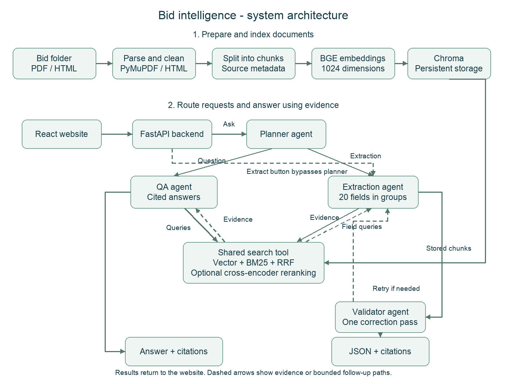
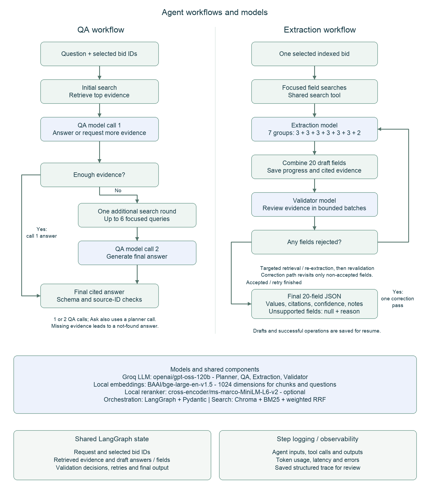

# System architecture

## Complete system

## QA and extraction workflows

## How the components work together

- **Prepare documents:** parse PDF/HTML, clean content, create chunks and store
  their text, metadata and 1024-dimensional embeddings in Chroma.
- **Search:** combine vector search and BM25 with weighted RRF; optionally
  rerank using a local cross-encoder. Return evidence with source locations.
- **QA:** retrieve first. The model answers immediately or requests one additional
  search round before a final answer. Source IDs and output schemas are checked.
- **Extraction:** extract seven small field groups, combine the draft, validate
  in batches, and allow one correction pass for rejected fields.
- **Model calls:** Planner, QA, Extraction and Validator share the configured
  Groq LLM. Embeddings and reranking run locally. Model names are configurable.
- **State:** LangGraph passes evidence, draft fields and validation decisions.
  Website extraction saves progress and successful operations for resuming.
- **Observability:** structured traces record step inputs, tool calls, outputs,
  token usage, latency and errors.

The website's Extract button bypasses the planner. Ask uses the planner and can
route to QA or extraction. Addendum handling is included in QA/extraction
instructions. Extraction call totals vary with validation batches and corrections.
