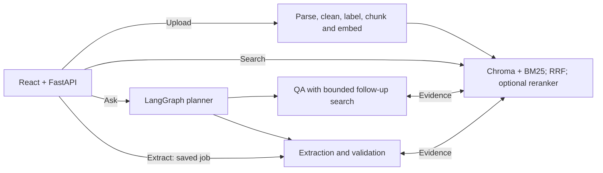

# RFP Intelligence

For a local demonstration, see [DEMO.md](DEMO.md). With dependencies installed,
`python -m scripts.demo` builds the UI and serves it together with the API.

## Architecture overview



See [the current architecture and extraction diagrams](docs/architecture.md) for
agent roles, local BGE-large 1024-dimensional embeddings, saved extraction progress
and resume, and implementation limits. The dedicated Extract action bypasses the
planner; natural-language Ask uses it. That document describes current behavior;
the stage-by-stage notes below include historical designs.

## Retrieval evaluation (source-reviewed revision)

The current set contains **20 questions total: 19 scored retrieval questions across
both bids and one manual bid-bond check**, covering the assignment’s sample
question types. Expanded/corrected references remain pending owner review.

| Configuration | Recall@5 | MRR@5 |
|---|---:|---:|
| vector | 0.8947 | 0.6886 |
| hybrid | 0.8026 | 0.7544 |
| hybrid_rerank | 0.8421 | 0.7061 |

The corrected scorer decodes table cells and typed table-fragment line breaks;
earlier scores under-counted valid evidence. This is a measurement correction, not
a retrieval-engine improvement. Previous measurements remain in
`evaluation/retrieval/experiments/original-scoring/`.

All 57 searches completed without errors using BGE-large and the same two stored
indexes. No Groq calls were made. Recall measures annotated evidence coverage;
MRR measures the rank of the first matching evidence. Equivalent source passages
count as alternatives, not extra obligations. Supporting context is not scored.
These results measure retrieval, not final-answer or extraction accuracy.

Review [the questions](evaluation/retrieval/QUESTIONS.md),
[the report](evaluation/retrieval/results.md), and
[the returned passages/settings](evaluation/retrieval/results.json).
[Submission and reproduction instructions](evaluation/retrieval/README.md) explain
how to rerun the evaluation. Keep these files in the submitted repository.
The original 25-question run is preserved in `evaluation/retrieval/baseline-v1/`;
its scores are not directly comparable because the questions and judgments changed.
Optional candidate-count and grouping experiments are described in
[evaluation/retrieval/experiments/comparison.md](evaluation/retrieval/experiments/comparison.md).
The experiment found no Recall/MRR benefit from increasing reranking candidates
from 20 to 40 or 60 on the existing index. Grouping reduced coverage: vector
0.8947 → 0.7500; hybrid 0.8026 → 0.7763; reranked 0.8421 → 0.7895 at 20
candidates. Keep the corrected scorer, original grouping and 20 candidates.
Grouping remains off by default. The source-review revision changed no production
search behavior; the later experiment adds optional grouping and a splitter fix.

## Docker and frontend startup

Reviewer setup is documented in [DOCKER.md](DOCKER.md). After configuring `.env`,
`docker compose up --build` is the intended single-command startup. The image
builds the React frontend, caches the embedding model, and serves the UI and API
on http://localhost:8000. Container execution still needs verification on Docker
Desktop; Docker is unavailable in the development environment used for this setup.
Workspace HTTP routes are connected to folder indexing and agent/search functions.
See [app/api/README.md](app/api/README.md) for execution order and storage details.

A Python project for searching bid documents, extracting 20 structured fields with
citations, and answering questions through a multi-agent workflow.

## Current stage

Project setup, Stage 1 file discovery, Stage 2A document models, and Stage 2B PDF
parsing, Stage 2C HTML parsing, Stage 2D folder processing, and Stage 3A content
preparation, Stage 3B baseline text chunking, and Stage 3C local embeddings are
implemented. Stage 3D persistent local Chroma and baseline semantic search are
also available.
Configuration, CLI, and a FastAPI health endpoint are available.
Stage 4A adds a Groq model connection and an upload-scoped search tool.
Stage 4B connects these through a small LangGraph Q&A workflow with structured
answers, citations and local execution traces. Stage 5A adds a separate extraction
agent. Stage 5B expands it to all 20 assignment fields in seven groups. Planner
Stage 7 adds a first planner/main graph. Comprehensive addendum coverage and validation remain pending. Stage 6A adds
document-role labels and filtered search as a reconciliation prerequisite.
Stage 6B adds instructions for explaining differing values and preserving cited
unresolved conflicts. Groq calls need a key; local search remains key-free.

## Stage 7: main graph and explicit specialist retrieval

The model chooses the high-level workflow once: Q&A, full extraction, or a direct
reply/clarification. Specialists then execute search directly using Python.
The obsolete choose_tool/execute_tools/router/tool_graph modules were removed.
No new dependency, embedding run or Chroma change is required.

```text
User request + selected discovery IDs
→ planner chooses workflow
  → Q&A: one direct search → one answer-generation call
  → Extraction: seven groups; one search per field + one model call per group
  → Reply: return the planner's greeting/clarification, without search
```

Normal model-call counts with evidence and no retries: standalone Q&A 1;
standalone full extraction 5; main-graph Q&A 2; main-graph extraction 6;
a main-graph greeting 1. These counts do not guarantee fitting token quotas.
The graph itself uses already indexed uploads; the connected HTTP adapter now
handles folder ingestion before routing questions. Multi-bid Q&A accepts a list
of discovery IDs. Validation, automatic correction and persistent chat memory
remain deferred. A separate comparison agent is an optional bonus.

Files:

- `agents/planner/models/task.py`: structured workflow decision.
- `agents/planner/graph/state.py`: request, upload ID, decision, specialist results, errors and trace.
- `agents/planner/prompts/instructions.py`: routing instructions.
- `agents/planner/nodes/choose_workflow.py`: one model call classifies the request.
- `agents/planner/graph/workflow.py`: conditional routing to existing child graphs.
- `agents/shared/retrieve_evidence.py`: direct searches and evidence deduplication.
- `agents/shared/retrieval_graph.py`: retrieval → specialist final step.
- `scripts/run_request.py`: main-graph command, trace and extraction output saving.

```bash
python -m scripts.run_request f7d17b24-5f09-476a-b72f-c146bb208b43 "How soon must equipment arrive?"
python -m scripts.run_request f7d17b24-5f09-476a-b72f-c146bb208b43 "Extract all 20 fields"
python -m scripts.run_request f7d17b24-5f09-476a-b72f-c146bb208b43 "Hello"
```

Main traces go to `logs/main-<run-id>.json`. A successful extraction writes
`outputs/fields-<discovery-id>.json`; failures preserve the prior output.
Tests run the real parent and specialist graphs with scripted models, checking
routing, model-call counts, citations, all 20 fields and parent/child failures.

```bash
python -m pytest tests/test_main_graph.py tests/test_question_answer_graph.py tests/test_extraction_agent.py tests/test_extraction_groups.py -q
```

Expected: 46 tests pass without Groq calls. Full suite: 226 passing tests.
This batch was tested offline, not with live Groq calls. Scripted model tests
verify execution contracts rather than real model classification accuracy.

## Stage 6B: explain differing values in Q&A and extraction

This small batch changes existing prompts and extraction checks. It adds no agent,
graph, embedding or database migration. Existing indexed chunks can be reused.
Q&A and extraction share the responsibility for interpreting applicable changes;
this role merge keeps the implementation small, as permitted by the assignment.

If retrieved sources give different values for the same requirement:

- An explicit, applicable amendment with established ordering: Q&A explains both
  values and which is current, with references to both sources. Extraction uses
  the updated value and explains the original value/change in notes, citing both.
- Unclear precedence: Q&A reports both values and says the conflict is unresolved
  (status `found`, because conflicting evidence was found). Extraction uses null,
  confidence 0, explanatory notes and the supporting citations.
- An unrelated addendum: it does not replace the requirement being answered.

Null without citations remains missing information. Null with citations represents
an unresolved conflict and requires non-blank notes. All source IDs must belong to
retrieved evidence. These checks validate structure/provenance, not whether the
model's conflict interpretation or notes are semantically correct.

Main changed files: `qa/prompts/instructions.py`,
`extraction/prompts/instructions.py`, and `extraction/models/check_fields.py`.
No extra model call is introduced. This behavior only operates on retrieved
passages; finding every applicable amendment is not guaranteed by the prompts.
Comprehensive retrieval evaluation and a full structured change log remain pending.

Offline verification:

```bash
python -m pytest tests/test_extraction_agent.py tests/test_extraction_groups.py tests/test_question_answer_graph.py -q
```

Expected: 37 tests pass. Scripted model tests check the graph/output handling,
not actual LLM reasoning. The full suite currently has 220 passing tests.

Optional live checks with fictional evidence (two Groq calls each):

```bash
python -m tests.inspect_addendum_behavior --case amendment
python -m tests.inspect_addendum_behavior --case conflict
python -m tests.inspect_addendum_behavior --case unrelated
```

Expected: amendment → June 15 with June 10 explained and both sources;
conflict → Q&A explains June 10 vs June 12, extraction null with both citations;
unrelated → deadline stays June 10 despite a RAM amendment. Inspect the printed
results and `logs/addendum-check-<run-id>.json`. This command checks final model
interpretation using supplied fictional evidence; it does not exercise retrieval
or change Chroma. Actual model output can vary.

Real Bid2 Q&A uses the existing upload, without reindexing:

```bash
python -m scripts.ask_question f7d17b24-5f09-476a-b72f-c146bb208b43 "What are the equipment delivery timing requirements? Explain differing dates or windows with citations."
```

Bid2 contains no addendums, so it cannot by itself verify amendment precedence.

Live verification for this batch: the fictional amendment check succeeded for
both Q&A and extraction, explaining June 10 → June 15 and citing both sources.
The real Bid2 Q&A run reached answer generation but hit Groq RateLimitError.
The live conflict check was not run because network approval was declined; the
unrelated case was not run live. Their scripted pipeline cases are covered offline.

## Stage 6A: document labels and filtered search

Before comparing an original RFP with addendums, retrieval needs to distinguish
those sources. This batch labels documents and makes the labels searchable; it
does not implement the Reconciliation agent or apply field overrides yet.
No new package or LLM call is needed.

Flow for new uploads:

```text
parse_folder → PDF/HTML parser → document_metadata.label_document
→ prepare → chunk → embed → Chroma stores labels with each chunk
```

`app/ingestion/document_metadata.py` uses filenames first, then role headings in
the first eight lines of the first text block. It recognizes RFP/PORFP, addendum,
specifications and affidavit signals. Saved HTML defaults to `bid_page` for the
assignment's input format. Explicit labels are preserved; unidentified PDFs stay
`unknown`. Addendum numbers are read only when clearly stated. Document dates
remain unset unless supplied explicitly: a submission deadline is not a document
issue date. These simple heuristics can miss unusual or misleading document names.

Inspect a provided folder without saving files or touching Chroma:

```bash
python -m scripts.inspect_document_metadata "Assignment-Data-Statements (AI Engineer-Emplay Inc)/Bid1"
```

Expected: original PDF `rfp`, two PDFs `addendum` with numbers 1 and 2, and HTML
`bid_page`. PDF image/OCR warnings remain independent of role classification.
Run the same command with `Bid2` to inspect its five documents.

Existing stored uploads retain their old labels until refreshed. To update the
existing Bid2 upload without creating a new upload ID or re-embedding:

```bash
python -m scripts.refresh_document_metadata f7d17b24-5f09-476a-b72f-c146bb208b43
```

`app/search/refresh_metadata.py` reads the selected upload's stored chunk metadata,
classifies each source using its filename and earliest stored chunk, and updates
Chroma metadata plus the source inside `chunk_json`. It does not update embeddings,
chunk IDs, upload IDs or stored text. A repeat run reports zero updates. Missing
initial text can leave a role unknown; the refresh does not read original files.
Old extraction output files are not rewritten by a metadata refresh.

The search CLI and agent tool now accept optional `doc_type` and `addendum_number`
filters. The agent cannot change the selected upload ID. Chroma receives addendum
numbers as integers, matching their stored type. Search evidence and new extraction
sources include document type, addendum number and any supplied document date.

Example searches (using the ID of an upload containing the corresponding files):

```bash
python -m app.search.search_cli search "RAM requirements" --discovery-id f7d17b24-5f09-476a-b72f-c146bb208b43 --doc-type specs
python -m app.search.search_cli search "submission deadline" --discovery-id YOUR_BID1_ID --doc-type addendum --addendum-number 2
```

For the current Bid2 upload, an addendum-only search correctly returns no matches.
Filtering reduces the eligible sources; it does not decide which conflicting
field value is correct or automatically improve ranking.

Main files: `document_metadata.py` labels sources; `pipeline.py` applies labels;
`store_metadata.py` stores/types filters; `schemas/search.py` defines filters;
`tools/document_search.py` exposes them; `search_cli.py` accepts terminal options;
`refresh_metadata.py` updates old labels. The two scripts provide inspection and
refresh commands. Tests cover classification, numeric filters, upload isolation,
unchanged vectors/text/IDs and refresh idempotence.

Verification: 212 tests pass, with lint/format checks passing. Real-folder
inspection identified all nine provided documents. The existing Bid2 upload
was refreshed: 42 chunks now have roles (15 affidavit, 7 bid_page, 10 specs,
10 rfp). Before/after comparison confirmed unchanged IDs, text, vectors and
upload identity. Specs-only search returned three specs matches; addendum-only
Bid2 search returned zero; a repeated refresh made zero updates.

## Stage 5B: extraction agent, all 20 fields

Q&A answers a question; extraction fills predefined fields. Both use the same
model connection, search tool and shared direct-retrieval graph, with different
instructions, final processing and output schemas. No new package is needed.

```bash
python -m scripts.extract_bid_fields f7d17b24-5f09-476a-b72f-c146bb208b43
```

This uses the existing indexed Bid2 upload. It does not parse or reindex files.
It prints all 20 fields (including nulls for missing evidence), saves readable JSON to
`outputs/fields-<discovery-id>.json`, and saves each run's trace under
`logs/extraction-<run-id>.json`. A successful run overwrites the same upload's
draft record. Failed runs save a trace and do not overwrite the output.
An older successful output can therefore still exist after a failed run.
The earlier three-field preview remains a historical result until a successful
full run replaces it. A draft is not yet a reconciled or validated final record.

For a smaller live test, run one group:

```bash
python -m scripts.extract_bid_fields f7d17b24-5f09-476a-b72f-c146bb208b43 --group delivery_and_documents
```

This writes `outputs/fields-<discovery-id>-delivery_and_documents.json`, separately
from the all-field output. Other `--group` choices:

| Group | Fields |
| --- | --- |
| `bid_details` | Bid Number, Title, Due Date, Bid Submission Type |
| `contract_requirements` | Term of Bid, Pre Bid Meeting, Installation, Bid Bond Requirement |
| `delivery_and_documents` | Delivery Date, Payment Terms, Any Additional Documentation Required, MFG for Registration |
| `products` | Contract or Cooperative to use, Model_no, Part_no, Product |
| `contacts_and_summary` | contact_info, company_name, Bid Summary, Product Specification |

All groups use the same extraction agent and registered search tool. Each starts
with fresh evidence and messages. The full command combines their fields and tags
trace steps by group. Groups currently run sequentially to limit concurrent API
bursts; this does not guarantee staying below provider rate limits. If a group
fails (including timeout/rate limit), the run stops with error; completed groups
remain in the trace record for inspection. Automatic resumption is not implemented.
Parallel group execution is deferred to orchestration with quota control.

`RFP_LLM_MAX_TOKENS` now defaults to 4096 (override in `.env`). Four-field
responses need room for both reasoning tokens and JSON. A live test at 1024
was truncated; the agent reports this explicitly and logs finish reason/usage.
The limit is a ceiling, not a request to use all tokens. No API key is changed.

Verification: 171 offline tests pass. A live `delivery_and_documents` run
returned the 45-day delivery window, invoicing conditions, required documents
and Dell as the manufacturer, with PORFP page 2 citations. This verifies one
four-field group; full 20-field factual accuracy is not yet evaluated.

Each field has `value`, `sources`, `confidence` and `notes`. Source entries include
file, page/section, chunk ID and supporting text for manual inspection. Missing
fields use `null`, no sources, confidence 0 and `Not found in retrieved evidence`. This does not prove a field
is absent from the entire folder; retrieval improvements are still pending.
Confidence is currently an uncalibrated model estimate of evidence support,
explicitly identified in `confidence_method`; it is not cosine similarity or a
measured probability. A later Validator and evaluation will improve that policy.

```text
agents/
  qa/                         # Q&A agent
    graph/state.py
    graph/workflow.py
    nodes/generate_answer.py
    prompts/instructions.py
    models/answers.py
  extraction/                 # Field extraction agent
    graph/state.py
    graph/workflow.py
    graph/extract_bid.py
    nodes/extract_fields.py
    prompts/instructions.py
    models/fields.py
    models/field_catalog.py
    models/check_fields.py
  shared/                     # Reused by both agents
    state.py
    retrieve_evidence.py
    retrieval_graph.py
```

The shared state holds search queries, evidence, messages, errors and traces.
The shared graph connects explicit retrieval to the specialist's final model node.
For each extraction group, Python makes one query for the first two fields and
one for the remaining fields, using their catalog descriptions. Search returns
top_k=3 for each query; evidence is deduplicated by chunk ID. One model call then
fills that group. Five groups therefore use ten local searches and five model
calls, with no model-driven tool selection. The standalone commands still work.

Execution: script → field groups → direct retrieval → model fills fields →
checks/citations → combined output. This baseline may miss relevant passages;
retrieval accuracy improvements remain a separate iteration.

- `extraction/models/field_catalog.py`: the exact 20 names, seven groups and field meanings.
- `extraction/models/fields.py`: the field schema and public result.
- `extraction/models/check_fields.py`: checks exactly one entry per requested
  field, valid citations, missing-value policy and non-empty supported values.
- `extraction/graph/state.py`: common tool state plus requested field names and the extraction draft.
- `extraction/prompts/instructions.py`: extraction task and JSON instructions.
- `extraction/nodes/extract_fields.py`: structured model output or missing fields
  for empty retrieval, validation, usage and latency logging.
- `extraction/graph/workflow.py`: builds the extraction agent and resolves cited
  chunk IDs to file/page/text sources. Refuses success without document retrieval.
- `extraction/graph/extract_bid.py`: runs groups sequentially and combines fields/traces.
- `scripts/extract_bid_fields.py`: selects the upload/group and prints/saves results.

```bash
python -m pytest tests/test_extraction_agent.py tests/test_extraction_groups.py tests/test_question_answer_graph.py -v
```

Expected: 37 tests pass without API calls. These include extraction structure,
source resolution, empty retrieval, missing fields, duplicate fields, unsupported
citations, invalid confidence, malformed JSON and finishing without retrieval.
The Q&A regression tests verify direct retrieval and answer generation.
This produces a 20-field draft. The main graph routes to this specialist as of Stage 7.
Two searches per group are a baseline and may miss relevant facts, particularly
in long RFPs. Reconciliation, validation and hybrid retrieval remain necessary.
Source-ID checks do not prove every claim's semantic accuracy; review source text.

## Stage 4B: dedicated Q&A workflow (simplified in Stage 7)

The dedicated Q&A graph always performs one explicit search using the question,
then generates a structured answer from its retrieved evidence. It does not
ask the model to choose tools or perform autonomous follow-up searches.
Empty evidence skips the model and returns not_found. Greetings should enter
through the main graph, which can reply without invoking this specialist.

```bash
python -m scripts.ask_question f7d17b24-5f09-476a-b72f-c146bb208b43 "How soon must equipment arrive?"
```

The existing upload is reused. The result has answer text and supporting source
records; `logs/qa-<run-id>.json` records retrieval, model usage and failures.
The graph calls `shared/retrieve_evidence.py`, then `qa/nodes/generate_answer.py`.
Citation-ID checks do not prove semantic correctness. Chat history and validation
remain deferred; multi-upload selection is supported.

## Stage 4A: model connection and agent search tool

Install: `python -m pip install -e '.[agents]'` (Groq SDK 0.37.1).
LangGraph will be added when we connect the workflow in Stage 4B.
Create a key at https://console.groq.com/keys and add these lines to your existing
local `.env` without replacing its other settings:

```dotenv
RFP_GROQ_API_KEY=your_key_here
RFP_LLM_MODEL=openai/gpt-oss-120b
RFP_LLM_TIMEOUT=30
RFP_LLM_MAX_TOKENS=4096
```

Do not share or commit the key. `Settings` keeps it as a masked `SecretStr`.

```bash
python -m scripts.check_groq_connection
```

Expected: `Connection working` and token usage (wording is model-generated).
This sends a small request to Groq, not document content. Without a valid key,
network access, available model and quota, the connection check fails.

Inspect the exact evidence payload the future agent will receive, without Groq:

```bash
python -m scripts.inspect_search_results f7d17b24-5f09-476a-b72f-c146bb208b43 "How soon must the equipment arrive?"
```

This UUID is the existing Bid2 upload in the local database. For another upload,
use its discovery ID from the index report. Expected: three JSON evidence items,
including PORFP page 2 mentioning delivery within 45 days of award.
No preview files are written and no documents are reindexed.

Execution: `inspect_search_results` → `SearchTool.run` → existing `search_documents` →
query embedding → Chroma → chunk text plus file/page/section references.
The selected upload is fixed by application code, not by model tool arguments.

Files:
- `shared/groq_client.py`: Groq requests, optional tool descriptions, assistant response,
  finish reason and token usage. Returns tool requests without executing them.
- `scripts/check_groq_connection.py`: manual model connection check.
- `tools/document_search.py`: validates search arguments, fixes the upload filter and
  returns cited evidence. Similarity is not answer confidence.
- `scripts/inspect_search_results.py`: manual inspection of that evidence.
- `config.py` / `.env.example`: key, model, timeout and response token settings.
- `pyproject.toml`: optional pinned Groq dependency.
- `tests/test_agent_model.py` / `tests/test_agent_search_tool.py`: isolated checks
  with fake model responses; no API requests or quota required.

```bash
python -m pytest tests/test_agent_model.py tests/test_agent_search_tool.py -v
```

Expected: seven tests pass. This verifies request handling, missing key handling,
failure propagation, tool input validation, upload isolation and citation payloads.
It does not measure model answer accuracy. SDK timeout/rate-limit failures still
propagate; workflow-level handling will be added with LangGraph. The SDK retries
transient failures once. Strict structured answers will be added separately from
tool-calling requests.

## Stage 2A: document models

These models define the parser's output; they do not extract content yet.

- `SourceMetadata`: preserves the discovered file record, plus the document role,
  addendum number, and document date. Unknown roles default to `unknown`; missing
  dates and addendum numbers remain `None`.
- `TextBlock`: extracted text with an optional heading and a page/section reference.
- `TableBlock`: optional headers, rows with a consistent column count, and a
  page/section reference. Empty cells can be `None`; no header is invented.
- `ParsingIssue`: a problem code, description, severity, and optional affected page.
- `ParsedDocument`: combines source metadata, text blocks, tables, and issues.

PDF content uses one-based physical page numbers. HTML uses section references
without PDF page numbers. A failed file can return a document containing issues
and no content. `page_count` can remain unknown if a PDF could not be opened.

Run the new tests and then check discovery and document models together:

```bash
python -m pytest tests/test_document_models.py -v
python -m pytest tests/test_discovery.py tests/test_document_models.py -v
```

Inspect the output shape using this **manually constructed example**, not real
extraction (use the Stage 2B command below for actual PDF content):

```bash
python - <<'PY'
from app.config import Settings
from app.ingestion.discovery import discover_bid_files
from app.schemas.content import TextBlock, TableBlock
from app.schemas.documents import ParsedDocument
from app.schemas.metadata import SourceMetadata

record = next(file for file in discover_bid_files(Settings().data_dir / "Bid2")
              if file.file_name == "PORFP_-_Dell_Laptop_Final.pdf")
document = ParsedDocument(
    source=SourceMetadata(**record.model_dump()),
    page_count=4,
    text_blocks=[TextBlock(page_number=3, text="Example text for demonstrating the model.")],
    tables=[TableBlock(page_number=3, headers=["Product", "Qty"], rows=[["Example laptop", "30"]])],
)
print(document.model_dump_json(indent=2))
PY
```

Expect the discovery ID and file paths inside `source`, followed by `page_count`,
`text_blocks`, `tables`, and `issues`. This checks structure and validation, not
parsing accuracy. Batch 2B below lets you inspect actual extracted PDF content.

## Stage 2B: PDF parsing and inspection

Activate `.venv`, then parse the one-page addendum:

```bash
python -m app.ingestion.pdf_preview \
  "Assignment-Data-Statements (AI Engineer-Emplay Inc)/Bid1/Addendum 2 RFP JA-207652 Student and Staff Computing Devices.pdf" \
  --output outputs/addendum2_extracted.json
```

Open `outputs/addendum2_extracted.txt` for readable text, tables, image locations,
and issues. Its `.json` counterpart contains the exact `ParsedDocument`.
The text should contain the July 9, 2024, 2:00 PM CST deadline on page 1.
Embedded logos also appear in `images`; this is information, not an error.

To inspect specifications and their part numbers:

```bash
python -m app.ingestion.pdf_preview \
  "Assignment-Data-Statements (AI Engineer-Emplay Inc)/Bid2/Dell_Laptop_Specs.pdf" \
  --output outputs/dell_specs_extracted.json
```

Compare the `TABLE` sections with the PDF. Descriptions should stay paired with
their SKU, including wrapped descriptions. Headers are retained in `rows`;
`headers` stays empty until they are reliably identified. The third page's terms
should remain text rather than a fabricated table.

For your own PDF, replace the input path and choose a new output filename. Quote
paths containing spaces. The output path must end in `.json`; this command creates
both JSON and a companion `.txt` file. Reusing an output path replaces that preview.
Discovery and `parse_pdf()` return in-memory records; only the preview command
explicitly saves copies for review.

```bash
python -m pytest tests/test_pdf_parser.py tests/test_pdf_tables.py -v
python -m pytest -v
```

Tests generate small PDFs containing known text, ruled and borderless tables,
mixed text/image pages, image-only pages, and blank pages. They also check corrupt
files and isolated extraction failures. The combined command checks earlier stages.

Implementation responsibilities:

- `pdf_parser.py`: opens PDFs, coordinates page extraction, logs issues, and closes pages.
- `pdf_tables.py`: extracts ruled tables and normalizes cells.
- `pdf_borderless.py`: geometric fallback for simple aligned two-column tables.
- `pdf_images.py`: records embedded images, including on pages with text.
- `pdf_preview.py`: saves extraction results for inspection.

Limits at this stage:

- No OCR is performed. Image records contain a name, page number, and bounding box
  `(left, top, right, bottom)` in PDF points from the top-left corner. They contain
  no extracted image text or saved image bytes. Mixed pages can still contain
  useful words inside images even when normal text extraction succeeds.
- Image detection does not identify vector-drawn content. The main RFP's W-9 pages
  54–59 return no text and are flagged for review regardless of image detection.
- A `no_text_extracted` issue does not prove that a page is blank or scanned.
- Text, table, and image extraction are independent. Failed components get issues;
  other content and later pages can still be returned. Unreadable PDFs get an error
  record; the preview command exits with status 1 for document-level errors.
- Table recognition is heuristic. Complex layouts and merged cells need visual
  verification. Page text retains table text too, so duplicates are possible.
- No automatic role classification, OCR, header/footer removal, or chunking yet.
  Unknown source metadata remains unknown. No issues is not a guarantee of
  complete extraction.

## Stage 2C: saved HTML parsing and inspection

We use `beautifulsoup4` (imported as `bs4`) with Python's built-in `html.parser`.
No browser, JavaScript execution, or network access is used during parsing.
Bytes are decoded using the HTML encoding declaration and Beautiful Soup's
encoding detection. Scripts, styles, templates, the head, comments, and elements
with the HTML `hidden` attribute are omitted. Navigation and repeated text may
remain; this is extraction, not full webpage cleanup or browser rendering.

Run from this project folder after activating `.venv`:

```bash
python -m app.ingestion.html_preview \
  "Assignment-Data-Statements (AI Engineer-Emplay Inc)/Bid2/Dell Laptops w_Extended Warranty - Bid Information - {3} _ BidNet Direct.html" \
  --output outputs/bid2_html_extracted.json

python -m pytest tests/test_html_parser.py -v
python -m pytest -v
```

Inspect `outputs/bid2_html_extracted.txt` alongside the saved webpage. Look for
`BPM044557`, `Dell Laptops w/Extended Warranty`, and the closing-date information.
The JSON uses the same `ParsedDocument` model as PDFs, but `page_count` and
`page_number` are `null`. Heading order creates stable `section-N` references
within an unchanged file. IDs are local to that document, not global identities.

Execution order: preview command → discovery → `parse_html()` → Beautiful Soup
→ section text and `extract_html_table()` → `ParsedDocument` → JSON/TXT previews.
Calling `parse_html(record)` directly returns the document in memory without
saving anything. Reusing a preview output filename replaces the preview.

- `html_parser.py`: decoding, content filtering, heading sections, and issues.
- `html_tables.py`: rows, captions, empty cells, and rowspan/colspan normalization.
- `html_preview.py`: command-line inspection and saving the two output files.
- `test_html_parser.py`: known content, sections, encoding, merged cells, malformed
  markup, unreadable files, image notices, and independent table failures.

Table header text stays in `rows`; we do not guess `headers`. Merged-cell text
is retained once, with `None` in covered positions. Nested tables and unsupported
spans are flagged; their text remains available even when table structure fails.
Table text also appears in text blocks, as in the PDF parser. Deduplication is
needed before indexing. HTML image contents are not fetched or read; files with
images receive an `image_content_not_read` notice. HTML images do not use the
PDF-specific bounding-box model. CSS visibility rules and content loaded only
by JavaScript are not reconstructed. No issues is not proof of full extraction.

## Stage 2D: process a whole folder

`parse_folder(folder_path)` is the real ingestion entry point. It calls discovery
once, selects `parse_pdf()` or `parse_html()` for each supported file, and returns
`list[ParsedDocument]` in relative-path order. It accepts any accessible folder;
the supplied Bid1/Bid2 paths are examples, not hardcoded inputs. Subfolders are
included. Every document shares the run's discovery UUID and input folder name.
Repeated calls create new UUIDs, even for the same folder. This is run identity,
not a persistent document ID or deduplication mechanism.

```python
from app.ingestion.pipeline import parse_folder

documents = parse_folder("path/to/your/folder")
for document in documents:
    print(document.source.relative_path, len(document.text_blocks), document.issues)
```

The pipeline returns in-memory data; it does not save output, run OCR, clean text,
create embeddings, or write to a database. A future API can call this function
after uploaded files are available on the backend. Missing/non-directory inputs,
folders without supported files, and inaccessible discovery paths raise errors.
File-level parsing problems stay in the affected document. Unexpected parser
exceptions produce a `parser_failed` error document and do not stop later files.
Processing is sequential at this stage. Review warnings as well as errors;
successful processing does not prove complete extraction.

For manual inspection, use the separate folder preview command:

```bash
python -m app.ingestion.folder_preview \
  "Assignment-Data-Statements (AI Engineer-Emplay Inc)/Bid1" \
  --output outputs/bid1_folder_extracted.json

python -m app.ingestion.folder_preview \
  "Assignment-Data-Statements (AI Engineer-Emplay Inc)/Bid2" \
  --output outputs/bid2_folder_extracted.json

python -m pytest tests/test_pipeline.py tests/test_folder_preview.py -v
python -m pytest -q
```

Expect four documents for Bid1 (three PDFs and one HTML) and five for Bid2
(four PDFs and one HTML). The combined JSON is an array of `ParsedDocument`
objects. Its companion `.txt` contains source references, extracted content,
and issues. Bid1 has warnings for the main RFP's textless pages and the HTML
image notice; these are retained for review. Output files are developer previews,
not final 20-field bid extraction results. Reusing a filename replaces its preview.
The command saves all results, then exits with status 1 if any document has an
error issue; warnings alone do not cause a failing exit status.

Responsibilities:

- `pipeline.py`: folder discovery, parser routing, and file failure isolation.
- `folder_preview.py`: CLI arguments, saving combined JSON/TXT, and summary counts.
- `preview_format.py`: readable document formatting used by the folder preview.
- `test_pipeline.py`: mixed formats, nested files, shared IDs, repeated runs,
  corrupt files, unexpected exceptions, and invalid inputs.
- `test_folder_preview.py`: saved results and command exit behavior.

Execution order: folder preview → `parse_folder()` → discovery → each parser →
list of documents → save previews. The application's future processing flow
will call the pipeline directly without requiring the preview command.

## Stage 3A: conservative content preparation

Preparation uses Python's built-in `re` and the existing Pydantic models. It does
not require a new dependency. `PreparedDocument` inherits the parsed document's
fields and location validation, adding `preparation_version: 1` so preview JSON
can be distinguished from raw extraction.

```python
from app.ingestion.pipeline import parse_folder
from app.ingestion.preparation import prepare_documents

parsed = parse_folder("path/to/your/folder")
prepared = prepare_documents(parsed)
```

This passes objects directly between functions. Preparation neither rereads a
preview JSON nor reparses the source files. It creates independent copies of
content, metadata, image records, and parsing issues. Neither function saves data.

Rules: normalize CRLF/CR line endings to LF, collapse repeated horizontal
whitespace, trim each line, and reduce multiple blank lines to one blank line.
Meaningful line breaks, paragraph separation, punctuation, case, dates, numbers,
and source references remain. Empty cleaned text blocks are excluded. Headings,
table captions, header cells, and row cells receive the same cleanup; optional
empty values become `None`. Table rows, columns, and merged-cell placeholders
remain in their original positions, including wholly empty rows.

We do not remove footers, navigation, or repeated text; reconstruct tables;
join wrapped emails; run OCR; classify passages; or create chunks/embeddings.
The PORFP table alignment limitation remains for the accuracy iteration. Text
and table representations may still repeat content and must be handled before
indexing. Parsing failures remain visible rather than disappearing in cleanup.

Use the existing preview command with `--prepare`:

```bash
python -m app.ingestion.folder_preview \
  "Assignment-Data-Statements (AI Engineer-Emplay Inc)/Bid2" \
  --prepare --output outputs/folder_prepared.json

python -m pytest tests/test_preparation.py tests/test_folder_preview.py -v
python -m pytest -q
```

Expect five files, zero files with errors, and one HTML image notice. The console
says `Stage: prepared content`. Inspect the `.txt` for readable content and the
`.json` for `preparation_version: 1` on every document. Omit `--prepare` to inspect
raw extraction. Reuse the same filename to avoid accumulating previews.

Execution order: folder preview → discovery and parsers through `parse_folder()`
→ `prepare_documents()` → whitespace cleanup → independent prepared documents
→ preview JSON/TXT. The next batch will create chunks from these objects.

- `schemas/prepared.py`: prepared document model, reusing existing validation.
- `ingestion/cleaner.py`: reusable whitespace functions.
- `ingestion/preparation.py`: prepares text and tables without modifying originals.
- `test_preparation.py`: cleanup, provenance, table shape, independent copies,
  retained failures, empty input, and repeatable preparation.

## Stage 3B: source-aware text chunking

Chunking uses our own small splitter and Python's built-in `re`; there is no new
dependency. The baseline creates text chunks from prepared PDF page blocks and
HTML heading sections, never combining different source blocks or files. Default
settings are a hard maximum of 2,000 characters and up to 200 characters of
overlap. These are characters, not model tokens; embedding token limits must be
checked when an embedding provider is added. Settings will be evaluated later.

The splitter prefers paragraph boundaries, then sentence punctuation, then
whitespace, searching in the latter part of the size window. It adjusts overlap
forward to a word boundary where possible. Overlap can be smaller than requested.
Long unbroken words/URLs use hard character splits. Each chunk records exact
zero-based, end-exclusive offsets into its prepared block; all non-whitespace
content is covered. The splitter does not infer semantic categories.

```python
from app.ingestion.pipeline import parse_folder
from app.ingestion.preparation import prepare_documents
from app.schemas.chunks import ChunkSettings
from app.search.chunker import chunk_documents

prepared = prepare_documents(parse_folder("path/to/your/folder"))
results = chunk_documents(prepared, ChunkSettings(max_chars=2000, overlap_chars=200))
chunks = [chunk for result in results for chunk in result.chunks]
```

`Chunk` carries a UUID, source metadata (including folder name and discovery ID),
page/section, heading, content type, extraction method, block index, and character
range. UUIDs repeat for the same input within a discovery run but change for a
new discovery ID. They are not cross-upload deduplication identifiers.
`ChunkedDocument` retains the whole prepared document and issues alongside chunks
and settings. All returned evidence is independent of the caller's original data.

Text chunks retain their original IDs, offsets and splitting rules. Detected tables
also produce `content_type: table` chunks: whole rows, known headers, table ID,
and row ranges are retained separately. Oversized rows use smaller embedding
fragments while preserving the complete structured row for reconstruction.
Images remain unread and do not produce chunks. Overlap and page text containing
the same table can still produce duplicate evidence; this is not full deduplication.

The splitter is separate from document assembly and preview formatting, so future
OCR producers can use the shared chunk contract without replacing discovery or
parsing. No embeddings or index are created by the chunking function itself.

```bash
python -m app.ingestion.folder_preview \
  "Assignment-Data-Statements (AI Engineer-Emplay Inc)/Bid2" \
  --chunks --output outputs/folder_chunks.json

python -m pytest tests/test_text_splitter.py tests/test_chunker.py tests/test_chunk_preview.py -v
python -m pytest -q
```

`--chunks` includes preparation automatically; adding `--prepare` is unnecessary.
Custom settings: `--chunk-size 1000 --overlap 100`. Size must be positive and
overlap must be nonnegative and smaller than size. The console prints the stage,
chunk total, and file-level extraction summaries. The JSON is an array whose
entries contain `document`, `settings`, and `chunks`. The `.txt` shows chunk
contents, source references, offsets, lengths, and issues. Raw and prepared
preview modes keep their previous JSON shape. Reusing filenames replaces previews.

Responsibilities:

- `schemas/chunks.py`: validated chunk/settings/output contracts.
- `search/text_splitter.py`: size, boundaries, overlap, and character offsets.
- `search/chunker.py`: assembles native-text chunks with source information.
- `ingestion/chunk_preview.py`: readable chunk inspection.

Execution order: folder preview → `parse_folder()` → `prepare_documents()` →
`chunk_documents()` → `split_text()` per block → save chunk previews. Actual
application code passes the returned objects directly to the next step; JSON
files are inspection copies, not required pipeline inputs.

## Stage 3C: local embeddings

Install the optional embedding runtime in the project virtual environment:

```bash
python -m pip install -e '.[dev,embeddings]'
```

The package is pinned to `sentence-transformers==5.1.2` in `pyproject.toml`.
The default model is `BAAI/bge-large-en-v1.5`, pinned to revision
`d4aa6901d3a41ba39fb536a557fa166f842b0e09` in configuration and `.env.example`.
Its native output has 1024 dimensions; Sentence Transformers `truncate_dim=1024`
is explicitly configured.
Both document and question embeddings use this setting. It produces 1024-dimensional, unit-normalized vectors with a 512-token input
limit. CPU is the default device, so no GPU is required. The first real run needs
internet to download the model into `storage/models`; later runs reuse this
ignored cache. Git contains code/configuration, not the model weights, virtual
environment, or generated vectors. Model and package pins do not constitute a
complete dependency lock or guarantee bit-identical floating-point output across
hardware. Record runtime details when comparing evaluation results.

The BGE query instruction is applied only to questions, not document chunks:
`Represent this sentence for searching relevant passages: `.
See the [model card](https://huggingface.co/BAAI/bge-large-en-v1.5) and
[package release](https://pypi.org/project/sentence-transformers/5.1.2/).
Model name, revision, batch size, cache directory, device, and query instruction
are configurable through `RFP_EMBEDDING_*` settings. Changing a model requires
matching its revision and query conventions; old and new embedding spaces must
not be mixed in an index.

The provider loads the model lazily, once per instance. It checks every input
with the real tokenizer, including special tokens and the query instruction,
before calling `encode()` in batches. Oversized inputs fail clearly; no silent
truncation is allowed. Our 2,000-character chunk baseline is not a token limit:
one Bid2 input has 517 tokens and is rejected. Use the tested 1,000-character,
100-overlap configuration below. This is an explicit setting change, not an
automatic rechunking policy. Different documents can still exceed token limits.

```bash
python -m app.search.embedding_preview \
  "Assignment-Data-Statements (AI Engineer-Emplay Inc)/Bid2" \
  --chunk-size 1000 --overlap 100 \
  --query "How soon must the equipment arrive?" \
  --output outputs/folder_embeddings.json

python -m pytest tests/test_embeddings.py tests/test_local_embeddings.py tests/test_embedding_preview.py -v
python -m pytest -q
```

The preview runs parsing, preparation, chunking, and real embedding. JSON contains
`documents` (chunked documents retaining issues/tables/images) and
`embedding_result` (model information, chunk/vector pairs, optional query vector).
The readable `.txt` shows full chunk text and the first eight vector values.
Vector components are neither probabilities nor confidence scores. Output files
are inspection copies, not vector-store persistence. Reusing a filename replaces
its successful preview. An embedding failure writes no new preview. Available
embeddings are saved even when other files have parsing errors, then the command
exits with status 1. Warnings alone do not fail the command.

After the initial successful model download, verify cached operation by prefixing
the same command with `HF_HUB_OFFLINE=1 TRANSFORMERS_OFFLINE=1`. This requires the
selected revision to be fully cached. Network access is otherwise permitted for
the library's cache/download checks; document text is encoded locally and is
not sent to a remote embedding API. Heavy embedding dependencies are optional;
automated tests use small provider/model doubles and require no model download.
The real-model command above is the separate integration check.

Responsibilities:

- `schemas/embeddings.py`: validates vector dimensions, finite values, nonzero
  norms, normalization, model identity, and unique chunk IDs.
- `search/embedding_provider.py`: replaceable document/query embedding interface.
- `search/local_embeddings.py`: pinned local model, token checks, and BGE encoding.
- `search/embeddings.py`: pairs provider outputs with independent chunk copies.
- `search/embedding_preview.py`: manual folder inspection and saved JSON/TXT.

Application code passes chunks directly into the service without reading JSON:

```python
from app.search.embeddings import embed_chunks
from app.search.local_embeddings import LocalEmbeddingProvider

provider = LocalEmbeddingProvider()
result = embed_chunks(chunks, provider, query="When is delivery?")
# Reuse provider to avoid reloading the model for each request.
```

Execution order: folder → parsers → preparation → chunking → provider tokenizer
checks → batch model encoding → validation → embedding results. Persistent vector
storage, dense search, hybrid retrieval, and answer generation are later batches.
Table/image limitations remain unchanged; unread images have no embeddings.

## Stage 3D: persistent Chroma and baseline dense search

Install the pinned local database and embedding runtime:

```bash
python -m pip install -e '.[dev,embeddings,storage]'
```

`chromadb==1.1.1` is the optional `storage` dependency. Configuration defaults to
`RFP_VECTOR_DB_DIR=storage/chroma` and `RFP_VECTOR_COLLECTION=rfp_chunks`.
The local persistent client stores database/index files on disk. No hosted
account or API key is required. Generated databases and upload reports are ignored
by Git. Reviewers create their own index with the command below.

```bash
python -m app.search.search_cli index \
  "Assignment-Data-Statements (AI Engineer-Emplay Inc)/Bid2"

python -m app.search.search_cli search \
  "How soon must the equipment arrive?" --folder-name Bid2 --top-k 3

python -m pytest tests/test_chroma_store.py tests/test_indexer.py tests/test_search_service.py -v
python -m pytest -q
```

The indexing command uses a 1,000-character maximum and 100 overlap by default,
explicitly matching the tested embedding configuration. Override with
`--chunk-size` and `--overlap`; token guards remain active. A fresh Bid2 upload
stores 42 chunks. Existing folders are not parsed or embedded again when a new
folder is added. Every new indexing invocation is a distinct upload/discovery
UUID, including repeated indexing of the same folder, as requested. This can
produce duplicate content across uploads. Upserting identical chunk IDs is
idempotent; cross-upload/file-hash deduplication and selective changed-file
updates are not implemented in this baseline.

The console prints the discovery ID, database path, chunk counts, and parsing
issues. A report under `storage/manifests/<discovery_id>.json` retains model and
chunk settings plus per-file chunk counts and issues, including failed files.
If no text chunks are available, indexing fails rather than recording a successful
upload. Otherwise available chunks can be stored despite other files' parsing
errors, with a nonzero CLI exit status. Database upserts are batched and report
writing is separate; this is not an atomic transaction across a complete upload.
Failed multi-batch operations may need a retry/cleanup policy in a later iteration.

Each database record stores our existing vector, chunk text, filterable metadata,
and the complete serialized chunk to reconstruct citations and source offsets.
Chroma's automatic embedding function is disabled: we supply document and query
vectors from the same BGE provider. Cosine distance is used; search returns
`similarity = 1 - distance`, not answer confidence. Nearest-neighbor results can
be irrelevant; there is no relevance threshold, reranking, or retrieval evaluation
yet. Model/revision/dimensions/normalization/query conventions are checked to
prevent mixing incompatible embedding spaces in a collection.

Search only embeds the question. It does not read original documents, rerun
parsing, or embed saved chunks again. It works after restarting the command.
Filter with `--folder-name`, `--discovery-id`, or `--file-name`; multiple filters
are combined with AND. Folder name alone searches all stored uploads with that
name. Use the printed discovery UUID to target one upload. No matching records
returns zero hits. Searching before indexing gives a clear error.

To use a separate database or model collection, put global options before the
subcommand, for example:

```bash
python -m app.search.search_cli --db-path storage/demo_chroma \
  --collection demo_chunks index "path/to/folder"
```

After the model is cached, `HF_HUB_OFFLINE=1 TRANSFORMERS_OFFLINE=1` can prefix
either command for offline operation. Database tests use actual Chroma with tiny
known vectors, not the embedding model; they include a subprocess restart check.
They skip if the optional storage package is absent. Indexing/service tests use
test providers and require no model download.

File interactions:

- `search_cli.py`: terminal arguments, creates provider/store, calls indexing or
  search, and saves the indexing report.
- `indexer.py`: existing folder parsing → preparation → chunking → embedding →
  store upsert → upload report.
- `service.py`: checks provider compatibility → query embedding → store search.
- `vector_store.py`: shared storage interface, keeping services independent of
  Chroma for a future external adapter.
- `chroma_store.py`: disk persistence, supplied-vector writes, cosine queries,
  filtering, and reconstruction of chunks.
- `store_metadata.py`: metadata encoding, filter encoding, and model comparisons.
- `schemas/search.py`: index reports, filters, and cited result models.
- `config.py`, `.env.example`, `pyproject.toml`: database path/name and pinned
  package configuration.

This remains a local, single-application baseline. Production deployment requires
durable storage or a server/managed database adapter. BM25/hybrid retrieval,
incremental changed-file management, and LLM answers/agents remain later stages.

## Stage 1: file discovery

`discover_bid_files(folder_path)` accepts any accessible folder path and returns a
list of `FileRecord` objects in memory. It does not read document contents or save
the records. Each call generates a new UUID (`discovery_id`) shared by all records
from that call. `folder_name` records the input folder's name, so repeated discovery
of the same folder has the same name and a different ID.

From the project folder with the virtual environment activated:

```bash
python - <<'PY'
from app.config import Settings
from app.ingestion.discovery import discover_bid_files

files = discover_bid_files(Settings().data_dir / "Bid1")
for file in files:
    print(file.model_dump_json(indent=2))
PY
```

Supported formats are PDF, HTML, and HTM (case insensitive). Subfolders are included,
and records are sorted by relative path. Unsupported files and symbolic links are
skipped. Full and relative paths distinguish files with identical names in different
subfolders. Relative input paths resolve from the caller's working directory.
Missing paths, non-directory inputs, and folders with no supported files raise clear
errors. Inaccessible subfolders raise their filesystem error rather than being
silently skipped. These errors can be translated into HTTP responses when an API
endpoint is added.

## Setup

Run these commands from the `Emplay_Assignment` folder using Python 3.10 or newer:

```bash
python3 -m venv .venv
source .venv/bin/activate
python -m pip install -e '.[dev]'
cp .env.example .env
python main.py check-config
python main.py serve --reload
```

After installation, `rfp serve --reload` is also available.
The health endpoint is at http://127.0.0.1:8000/health and interactive API documentation
is at http://127.0.0.1:8000/docs. Health returns `{"status":"ok"}`; it only checks that
the application responds.

Configuration is loaded from the project `.env` file and environment variables prefixed
with `RFP_`. Environment variables take precedence. Relative data and output paths resolve
against the project folder, regardless of the working directory. The supplied assignment
files remain in their original folder. Set `RFP_DATA_DIR` to use another data directory.

## Project structure

```text
Emplay_Assignment/
├── Assignment-Data-Statements (AI Engineer-Emplay Inc)/
│   ├── Assignment-AI Engineer.pdf
│   ├── Bid1/
│   └── Bid2/
├── app/
│   ├── main.py          # FastAPI application factory
│   ├── cli.py           # serve and check-config commands
│   ├── config.py        # Environment settings and paths
│   ├── api/             # HTTP routes; health is implemented
│   ├── ingestion/       # Discovery, PDF/HTML parsing, and inspection
│   ├── search/          # Planned: chunks, indexes, retrieval, reranking
│   ├── agents/          # qa/, extraction/, planner/, shared/
│   ├── shared/          # Shared Groq model connection
│   ├── tools/           # Agent-facing document search
│   ├── schemas/         # File records, source metadata, and parsed content models
│   ├── core/            # Planned: LLM client and structured tracing
│   └── prompts/         # Planned: versioned agent prompts
├── tests/               # Discovery, schema, and PDF tests; search tests planned
├── eval/                # Retrieval cases and configuration comparisons
├── storage/             # Generated indexes and ingestion manifests
├── outputs/             # Generated bid JSON and Q&A results
├── logs/                # Generated execution traces
├── main.py              # Project entry point
├── pyproject.toml       # Dependencies and tool configuration
└── .env.example         # Safe configuration template
```

## Implementation sequence

1. **Project setup:** runnable service, configuration, and folder structure.
2. **Ingestion:** normalized document models, PDF/HTML parsing, tables, page-level
   extraction checks, source metadata, and parsing tests.
3. **Search baseline:** chunking, embeddings, persistent indexing, independent search,
   and initial evaluation cases.
4. **First agent workflow:** retrieval tool, shared state, and cited answers.
5. **Full retrieval:** BM25 and vector fusion, metadata filters, reranking, query
   expansion, and incremental indexing.
6. **Complete extraction:** all 20 fields, addendum reconciliation, validation,
   bounded retries, concurrent field groups, and traces.
7. **Evaluation and submission:** at least 15 retrieval cases, comparison of at least
   two configurations, Recall@k and MRR (or nDCG), two bid JSON files, at least 10 cited
   Q&A examples, an extraction trace, architecture diagram, and demo preparation.

FastAPI is the initial API framework. LangGraph is the proposed orchestration framework;
its dependency will be added when that workflow is implemented. Parsing, embedding,
vector-store, and model-provider dependencies will also be added in their relevant steps.

## Development

```bash
ruff check .
ruff format --check .
```

Run `pytest` to verify discovery, document schemas, and PDF/HTML extraction.
Search tests will be added with their implementation.
Generated storage, logs, outputs, and local secrets are ignored by Git. Curated submission
artifacts should be explicitly added to a separate tracked directory in the final stage.


## Selected folders and comparisons

Each folder upload has a unique discovery ID, including repeated uploads of the
same folder. SearchTool now accepts a UUID or a list. It runs a separately scoped
search for each selected upload (three results per upload by default), preserving
folder_name and discovery_id on evidence and citations. The Q&A prompt compares
bids separately and applies addendum precedence only inside the same upload.
The main graph stores discovery_ids and supports comparison questions. Structured
20-field extraction requires one selected folder to avoid mixing bid records.

Existing single-ID terminal commands still work. Add `--also` for each extra ID:

```bash
python -m scripts.run_request FIRST_DISCOVERY_ID "Compare warranty requirements" --also SECOND_DISCOVERY_ID
python -m scripts.ask_question FIRST_DISCOVERY_ID "Compare warranty requirements" --also SECOND_DISCOVERY_ID
# Inspect passages without calling Groq:
python -m scripts.inspect_search_results FIRST_DISCOVERY_ID "warranty" --also SECOND_DISCOVERY_ID
```

Replace both placeholders with real indexed UUIDs. No reindex is needed merely
for this change: existing chunk metadata already has folder_name and discovery_id.
Index a second folder if only one upload is present. These commands use Groq;
tests below run offline and do not consume its quota.

The frontend queues up to 20 folders in one chat, processes them sequentially,
and sends that chat's discovery IDs to POST /api/sessions/ask or /api/sessions/search.
Source cards identify their folder; the evidence drawer also shows the full ID.
ProcessingJob exposes discovery_id with session_id as its matching legacy alias.
The HTTP service now connects upload processing and multi-folder queries to the
core pipeline. The frontend queues folders in one chat and sends their discovery
IDs together. Terminal commands remain available independently.

Verify this change:

```bash
python -m pytest tests/test_multiple_uploads.py tests/test_workspace_routes.py tests/test_chroma_store.py -q
cd frontend
npm run build
```


## Browser-to-pipeline connection

Start the server from the project folder (activate the virtual environment first):

```bash
python main.py serve
```

Open http://127.0.0.1:8000. With the built frontend present, FastAPI serves both
UI and API. Add Bid2, process the chat's folders, and wait for Ready. Try Search
for `Delivery within 45 days` first (no Groq quota), then Ask `How soon must the
equipment arrive?` (uses Groq). Inspect the citation drawer for folder/file/page.
To compare, add Bid1 and Bid2 to a new chat before processing and ask a question
about both folders. A Groq key in .env and the agents/embeddings/storage extras
must be installed. Restart the server after changing .env.

Saved uploads, jobs and index reports live under storage; answers never write into
the original assignment folders. The connected service persists job status and
reuses the existing index_folder / run_request functions. It loads the embedding
model lazily and runs core operations in worker threads. Use one server worker.
Successful jobs survive restart; interrupted jobs require a fresh upload. Upload
limits are configurable in .env.example. See app/api/README.md for all components.

Tests for this integration:

```bash
python -m pytest tests/test_connected_workspace.py tests/test_workspace_failures.py -q
```

These use real parser/index/Chroma/graph code with offline model boundaries.
A separate manual smoke check uploads the real Bid2 PORFP PDF through HTTP and
searches it using the cached BGE model in an isolated temporary database. No Groq
calls were used to verify this connection; actual model answer quality and token
quotas remain subject to the configured provider.

Verification after connection: 252 Python tests passed and Ruff passed. The real
Bid2 PORFP smoke check returned source pages 2, 2 and 3, including the stated
45-day delivery requirement, with cached BGE embeddings and no Groq calls.


## Embedding token-limit compatibility

Character count does not guarantee a model token count. Dense Bid1 text can exceed
BGE's 512-token limit even inside the default 1000-character chunks. Before
embedding, providers exposing count_tokens trigger token_safe_chunks: safe chunks
remain unchanged; oversized chunks are split into smaller overlapping spans and
checked recursively using the actual tokenizer, including special tokens.
Filename, folder/discovery ID, page, section, content type and exact source offsets
are preserved. Child IDs remain deterministic. No content is silently truncated.
Index reports count the final embedded chunks; embedding previews show the final
chunks too. Existing stored uploads are unchanged; retry failed uploads after
restarting the backend. Image-only/OCR notices remain independent of this fix.
## Hybrid retrieval configuration

Search tools and the terminal search command use vector search plus BM25 by default.
BM25 uses `rank-bm25==0.2.2` (BM25Plus) over existing Chroma chunk text. It does not
reparse files or generate document embeddings. The same upload/file/addendum filters
apply to both methods. Cached keyword indexes rebuild when the saved text or IDs change.

Set these in `.env`, then restart the backend:

```dotenv
RFP_SEARCH_MODE=hybrid
RFP_SEARCH_VECTOR_CANDIDATES=20
RFP_SEARCH_KEYWORD_CANDIDATES=20
RFP_SEARCH_VECTOR_WEIGHT=1
RFP_SEARCH_KEYWORD_WEIGHT=1
RFP_SEARCH_RRF_K=60
RFP_SEARCH_FIELD_KEYWORD_BOOSTS='{"contact_info":1.5,"Product":1.5}'
```

The field map replaces the default map, rather than merging with it; `{}` disables
field boosts. The defaults also boost Bid Number, Model_no and Part_no by 1.5.
Weights are relative votes in weighted RRF, not probabilities. Candidate counts
control internal retrieval; `top_k` still controls final passages per selected upload.
The extraction evidence budget remains 12 chunks / 12,000 serialized characters per group.

API queries and search-tool calls can override `mode`, `vector_candidates`,
`keyword_candidates`, `vector_weight`, `keyword_weight`, and `rrf_k`.
Extraction supplies `field_name` automatically. An explicit keyword weight overrides
the field boost. Otherwise effective keyword weight is the global weight times
the field multiplier. Q&A uses global defaults unless an override is supplied.

The terminal search command accepts corresponding flags such as `--mode vector`,
`--mode hybrid`, `--keyword-weight 2`, and `--field-name contact_info` for comparisons.
Hybrid hits expose `retrieval_score` and each method's rank. `similarity` remains
cosine similarity when vector search retrieved the chunk; keyword-only hits have
`similarity=null`. An RRF score is not answer confidence.


### Table-aware retrieval

A detected table receives an ID scoped to its discovery ID, file, page/section
and table position. `table_chunks.py` groups complete rows for indexing.
`token_safe_chunks.py` checks the embedding tokenizer's limit. Chroma persists
table identity, row ranges and structured cells alongside the searchable text.
Vector and hybrid retrieval return only the matched stored chunks, with their
original IDs, text and row ranges. There is **no automatic table expansion** in
standalone search, QA or extraction. `table_context.py` remains an unused helper;
retrieval does not call it or fetch neighbouring rows by table ID.
Null/merged cells and repeated rows remain as detected by the parser; this does
not repair PDF alignment errors.

Unexpanded table chunks are marked `table_complete: false`. QA and extraction
must not claim that a partial chunk proves a complete list. Evidence remains
bounded by 12 chunks and 12,000 serialized JSON characters. Oversized individual
chunks are skipped rather than truncated; traces expose omitted and partial
table evidence. This bound is not an exact LLM token limit. Smaller evidence can
reduce token usage, but a filled evidence budget and output reservations can
still cause Groq waits.

Existing indexes and table metadata remain compatible. Restart the backend to
use chunk-only retrieval; no re-indexing or database wipe is required for this
change. Creating table chunks in an older text-only index still requires indexing.

Offline regression checks (temporary databases; no Groq requests):

```bash
python -m pytest tests/test_table_retrieval.py tests/test_chunker.py tests/test_token_safe_chunks.py tests/test_hybrid_search.py tests/test_evidence_selection.py -q
python -m pytest -q
```


### Cross-encoder re-ranking

`sentence-transformers==5.1.2` already supplies `CrossEncoder`; no additional
Python package is required. The separate relevance model is
`cross-encoder/ms-marco-MiniLM-L6-v2`, pinned to revision
`233902d25c440f23af6f7d6e94d2946bac0bee0a` for reproducibility.
Its weights download on first use into the ignored `storage/models` cache,
then run locally. No Groq calls or document re-embedding are needed.

Flow: vector + BM25 candidates → weighted RRF → cross-encoder relevance scores
→ final top_k stored chunks → existing evidence budget
→ QA/extraction. Vector-only mode can also use the reranker.
`RFP_SEARCH_RERANK_CANDIDATES=20` controls the pool scored, separately from final
`top_k`. Enabled searches request at least that many candidates from each method,
subject to available filtered records. Metadata filtering happens before ranking.

`cross_encoder_reranker.py` lazily loads the model and scores each question/passage
pair. `rerank_windows.py` uses its tokenizer to split oversized passages into
fitting overlapping windows, retaining the highest window score for the original
chunk. No original evidence text or citation ID is changed. A question too large
for the model raises a clear error instead of being silently truncated. Scores
are relevance scores, not confidence or proof of answer correctness; the existing
cosine `similarity` and RRF `retrieval_score` retain their meanings.

The backend runtime reuses one reranker across requests; the shared search tool
serves standalone search, QA and extraction. HTTP sources and traces include
`rerank_score`. Failures propagate through the existing search/agent error path;
the system does not silently claim reranking succeeded when model loading fails.

Set `RFP_SEARCH_RERANK=true` in `.env` and restart the backend to enable it globally.
The supplied `.env.example` enables it; absent configuration preserves the previous
search behaviour. Individual search/API requests can override `rerank` and
`rerank_candidates`. No database migration or re-indexing is needed for reranking
itself. Table-aware retrieval still needs the table records from the preceding stage.

```bash
# Offline automated checks: scripted relevance scores, real temporary Chroma.
python -m pytest tests/test_reranker.py tests/test_hybrid_search.py tests/test_table_retrieval.py -q
# Real local model demonstration: first run downloads the model.
python -m tests.inspect_reranker
# Compare searches using the same saved discovery ID.
python -m app.search.search_cli search "Who is the procurement contact?" --discovery-id YOUR_ID --rerank
python -m app.search.search_cli search "Who is the procurement contact?" --discovery-id YOUR_ID --no-rerank
```

The small demonstration confirms execution and ordering on example passages.
Retrieval metrics and the 20-field extraction accuracy must still be measured
against the assignment bids; this change alone does not establish an accuracy gain.

Extraction currently processes three fields per model call (the last group has two). Each field retrieves five ranked chunks. Duplicate chunks are removed; up to 15 chunks fit within the existing 12,000-character evidence budget per call. QA keeps its existing search settings.


After the BGE-large embedding migration, restart the backend and upload/index each folder again.
The new `rfp_chunks_bge_large_1024` collection is separate from the old BGE collection;
old upload IDs do not have vectors in the new collection. The first indexing run
will download BGE-large into `storage/models`. Batch size defaults to 4 for local CPU use.
Chunk sizes remain unchanged. No Groq calls are needed to index documents.


PDF parsing now uses `PyMuPDF==1.26.5`. `pdf_parser.py` reads sorted page text;
`pdf_tables.py` reads detected table cells; `pdf_borderless.py` retains the simple
aligned-column fallback using PyMuPDF word coordinates; `pdf_images.py` records
image occurrences on text and image-only pages. OCR remains a separate future step.
`pdfplumber` is kept in development dependencies only for local comparisons.
To inspect parsing without loading the embedding model or calling Groq:

```bash
python -m app.ingestion.pdf_preview "Assignment-Data-Statements (AI Engineer-Emplay Inc)/Bid2/PORFP_-_Dell_Laptop_Final.pdf" --output outputs/pymupdf-porfp.json
```

BGE-large is the current local embedding model. Both chunks and questions use
`BAAI/bge-large-en-v1.5` and produce normalized 1024-dimensional vectors.
Only questions receive the BGE retrieval instruction. Its 512-token input limit
is checked with the actual tokenizer; oversized chunks are split before embedding.
Offline tests verify the shared provider without downloading weights or calling Groq.
Restart the server and index folders again to populate `rfp_chunks_bge_large_1024`.

To index a folder directly from the terminal with stage timings and embedding
batch progress (without Groq calls):

```bash
python -m scripts.index_folder "Assignment-Data-Statements (AI Engineer-Emplay Inc)/Bid1"
```

The script uses the same `PipelineRuntime.index` pipeline as the upload API and
saves the same manifest. Stop any running indexing job before starting this
command, so two local embedding processes do not compete for memory and CPU.
Terminal logs now show model loading, parsing, cleaning/chunking, embedding,
and Chroma persistence separately. The model download is cached, but embedding
all chunks is still required for each new upload.

You can reopen an indexed folder from the frontend using **Use an indexed folder**:
paste the discovery ID from a completed indexing run and click **Open folder**.
The backend checks the manifest and verifies vectors in the active collection,
then the folder can be used for Ask, Search and extraction without reindexing.
`GET /api/sessions/{discovery_id}` performs this check without loading an
embedding model or calling Groq. Cleared vectors or IDs from previous model
collections cannot be reopened; those folders need indexing with the current model.
Reopened folders list indexed filenames, but browser-local original files are
not available for preview unless they were uploaded in the current browser session.

## Current extraction validation

Full extraction now validates after all seven extraction groups, using combined,
budgeted batches and one correction attempt for rejected fields. See
[the current flow, model-call limits and tests](docs/extraction_validation.md).
Earlier stage notes describing seven per-group validation calls are superseded.
Eight calls is possible only when cited evidence fits one validation batch; larger
inputs need more batches and remain subject to Groq token limits.
